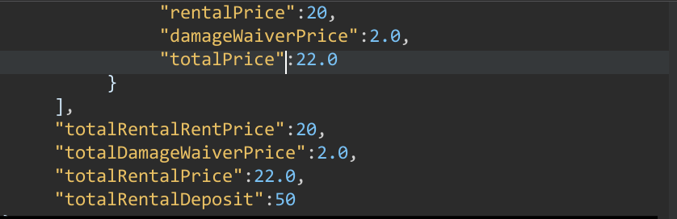
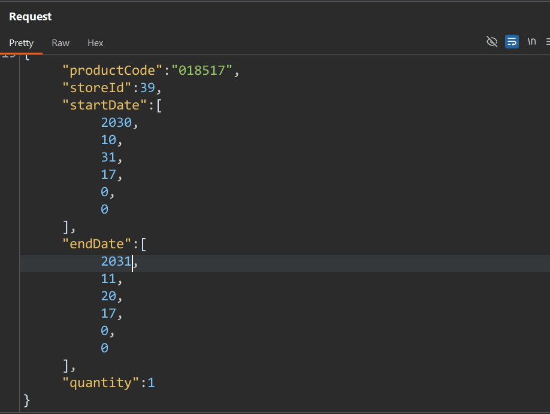
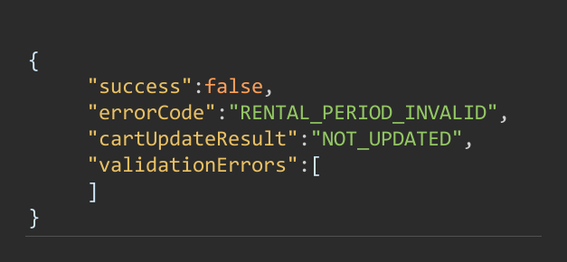
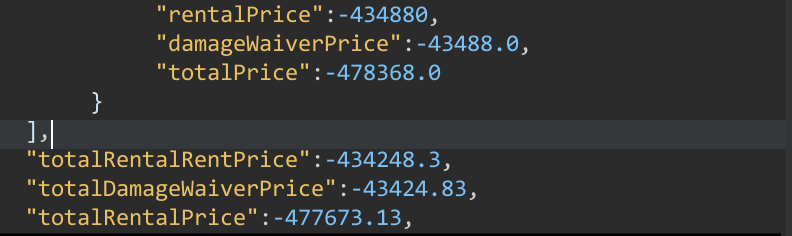

> Swapping the dates on a second add dragged a rental cart to −€477,673.13.

**Status.** Reported, fixed, and closed as a duplicate. Someone reached it before me. The reasoning is still worth writing down.

**Class.** Business logic. The second add skips the rental-period check and writes a negative line. Severity is medium: it needs an authenticated account. The minus showed up on the cart, and I saw it.

---

## TL;DR

The target is an e-commerce platform with a rental feature. You pick an item, choose a start and an end date, and the backend prices the line by its duration.

The first add rejects an end date that comes before the start. The create path checks the period. The second add of the same product returns `cartUpdateResult: UPDATED`. That update path accepted the reversed range and priced the line negative. One poisoned line pulled the rental cart to **−€477,673.13**.

That minus was on the cart. I saw it.

The create path and the update path do not share the same check. The first write is guarded. The second write is not.

---

## Scope and ground rules

- The target and the program are redacted. I am not naming the company.
- Black-box. I did not have the source. The requests and the cart are the evidence.
- I tested with my own account. The minus showed up on that cart.
- The figures omit request headers. Two original captures were the same file, so one of them is used.

---

## 1. Mapping the feature

**How I got here.** I opened a rentable product and watched the network tab while changing the rental dates.

The rental dates are not decoration. They ride on the cart line and drive the server-computed price.

```http Endpoint
POST /api/rental
```

```json Payload
{
  "productCode": "018517",
  "storeId": 39,
  "startDate": [2026, 10, 31, 17, 0, 0],
  "endDate": [2026, 11, 20, 17, 0, 0],
  "quantity": 1
}
```

The cart response gives each line a server-computed price.


*The dates travel with the line. This add was answered as an update.*

**Observed.** A valid rental prices correctly and positively. In the capture below: €20 rent, €2 waiver, €22 total, and a €50 deposit. The server owns the price.



*A normal period. The total stays positive.*

That is the right design, and it also means the pricing function is the single point of failure. The question stops being whether I can tamper with the price. It becomes whether I can hand the formula an input the developer never imagined. Dates are user-controlled, so that is the lever.

---

## 2. Finding the edges of the booking window

**How I got here.** Before trying anything clever, I probed the limits. I pushed the dates further into the future until the server pushed back.

**Observed.** An out-of-window period was rejected. The range was in the right order, start before end, but the end was too far in the future.

```json Request
{
  "productCode": "018517",
  "storeId": 39,
  "startDate": [2030, 10, 31, 17, 0, 0],
  "endDate": [2031, 11, 20, 17, 0, 0],
  "quantity": 1
}
```

```json Response
{
  "success": false,
  "errorCode": "RENTAL_PERIOD_INVALID",
  "cartUpdateResult": "NOT_UPDATED",
  "validationErrors": []
}
```



*The dates are in order.*



*They are simply outside the window.*

This refusal is the window check, not the reversed-range bug. It shows the create path can say no.

The server refuses a period that ends in 2031. The important part: the create path inspects the rental period and refuses it with `RENTAL_PERIOD_INVALID` before the line is created.

Hold that thought. The bug is a second path that does not run this same check.

---

## 3. How strict is the date validation?

**How I got here.** I sent the add-to-cart request ranges the form would not normally produce.

The create path enforces the window. A correctly ordered range that ends too far in the future is rejected with `RENTAL_PERIOD_INVALID` and `NOT_UPDATED`. The period check runs on create. The bug is the second write, which does not run that check.

---

## 4. The second add

This is the heart of it.

**How I got here.** I added a product, then added the same product again, and watched what the API called the result.

**Observed.** The second add came back as an update, not a new line.

```json Response
{
  "success": true,
  "cartUpdateResult": "UPDATED",
  "validationErrors": [],
  "cart": { … }
}
```

The resulting rental line did not carry the dates I had just sent. The cart identifies a rental line by product, not by the dates on the request.

One action, "add this item," resolves to two server behaviors.

- **First add, create path.** The line does not exist yet. The server creates it, runs the period validation from section 2, and prices it. The price is positive.
- **Second add, update path.** The line already exists, keyed by product. The server updates it with the new dates. This is where the reversed range got through and the line price went negative.

The update path reads the new start and end and does not run the period check the create path runs. Create rejects a bad period. The second add comes back `UPDATED`. The cart then holds a negative line.

The second add used a range reversed by about a year, so the duration goes strongly negative:

```json Payload
{
  "productCode": "018517",
  "storeId": 39,
  "startDate": [2031, 10, 31, 11, 0, 0],
  "endDate": [2030, 10, 31, 10, 0, 0],
  "quantity": 100
}
```

The takeaway: two code paths for one action, and only one of them is guarded. Worth hunting in any cart, wishlist, or booking flow.

---

## 5. Why the price goes negative

The reversed range reaches a pricing function that never checks the sign. This shape produces the negative line I saw:

```text Pricing
function price(item, start, end):
    hours = (end - start) / 3600
    if hours < 24:
        return ceil(hours) * item.hourlyRate
    return ceil(hours / 24) * item.dailyRate
```

`hours` is negative. Any negative value is less than 24, so the function takes the hourly branch and returns a negative line price. There is no `hours > 0` guard. Create had already rejected a bad duration. Update did not, so the formula stored a negative price and the cart showed it.

The second add sent `quantity: 100`. The cart stored a line of −€434,880.00 and a rental total of −€477,673.13. Validation and pricing were two separate checks, and the update path skipped the first one.

---

## 6. The poisoned cart

**How I got here.** A cart is an aggregate. Once one line is negative, it drags the total down and offsets every positive line.

**Observed**, straight from the cart response:

| Field | Value |
| --- | --- |
| Poisoned line `rentalPrice` | −€434,880.00 |
| Poisoned line `damageWaiverPrice` (10%) | −€43,488.00 |
| Poisoned line `totalPrice` | −€478,368.00 |
| Cart `totalRentalRentPrice` | −€434,248.30 |
| Cart `totalDamageWaiverPrice` | −€43,424.83 |
| Cart `totalRentalPrice` | −€477,673.13 |

The poisoned line is −€434,880.00. The cart rent subtotal is −€434,248.30. The difference is €631.70 of positive rental lines, and the negative line swallows them. The cart total is that subtotal plus the 10% damage waiver.



*The cart after the reversed rental. The minus is on the cart.*

The minus showed up on the cart. I saw **−€477,673.13** there. The cart response carries the same numbers, so the cart is showing stored server state, not a display glitch.

---

## How the two paths line up

```text Paths
POST /api/rental
        |
        +-- no line yet ---- create
        |                      |
        |                      +-- period refused --> RENTAL_PERIOD_INVALID
        |                      +-- period accepted -> positive price
        |
        +-- line already there -- update
                                   |
                                   +-- reversed dates
                                         |
                                         +-- negative line
                                               |
                                               +-- poisoned cart total
```

---

## Root cause

1. No shared `end > start` check on the update path. The check lives on create. The second add skips it.
2. The pricing function has no check for a negative duration or a negative result.
3. The cart accepts the negative line and shows the negative total.

---

## Impact

- One reversed second add writes a negative rental line, and the cart total goes to **−€477,673.13**. I saw that minus on the cart.
- The negative line offsets the positive rental lines already in the cart.
- The store's cart total is no longer the price of the goods.

---

## Recommended fixes

1. Validate `end > start`, with the full datetime and timezone, on every path: create, update, and merge.
2. Put the period rules in one shared function called by both paths.
3. Reject non-positive durations and non-positive prices inside the pricing function itself.
4. At checkout, recompute the cart and fail if any line is `<= 0`.
5. Do not create a zero-payment order unless the free total was legitimately computed.
6. Add regression tests for reversed ranges, the edge of the booking window, add-twice, and add-after-update.

---

## Takeaways

- Hunt the second write. Create, update, and merge are separate paths, and the check sits on one of them. If the first add is clean, add again.
- Probe the edges. The booking window and the price are different code.
- "The server computes the price" is not the end of the story. Ask what inputs the formula was never tested with.
- The payment processor is not the business logic. It only sees the number it is given.

---

**Disclosure.** Published with the program's permission. The issue was reported, fixed, and closed as a duplicate of an earlier report.

*Thanks for reading. This is my first writeup.*
