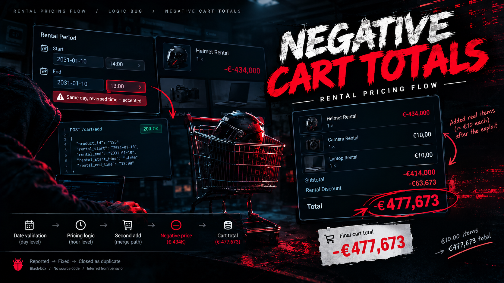
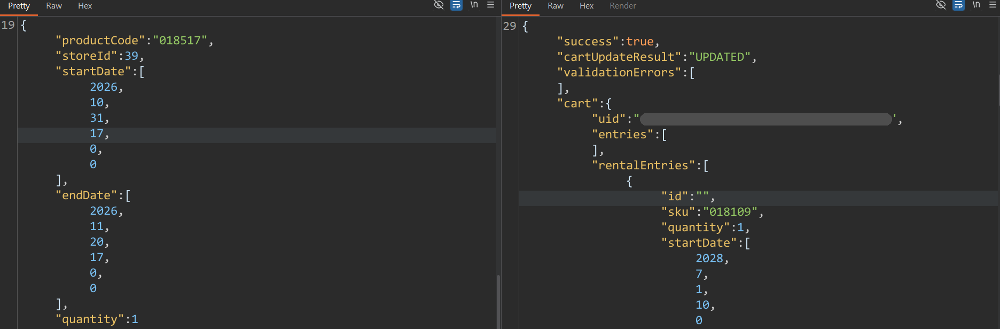
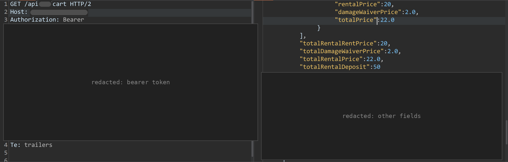
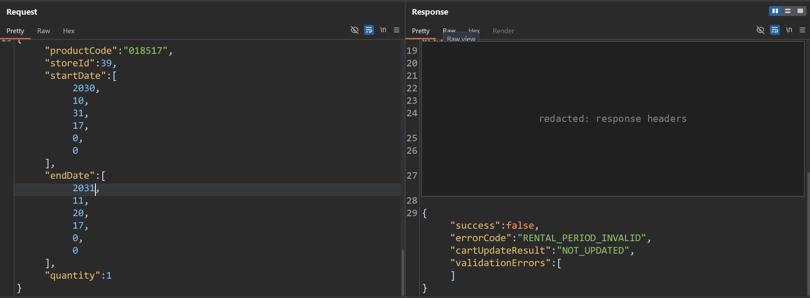
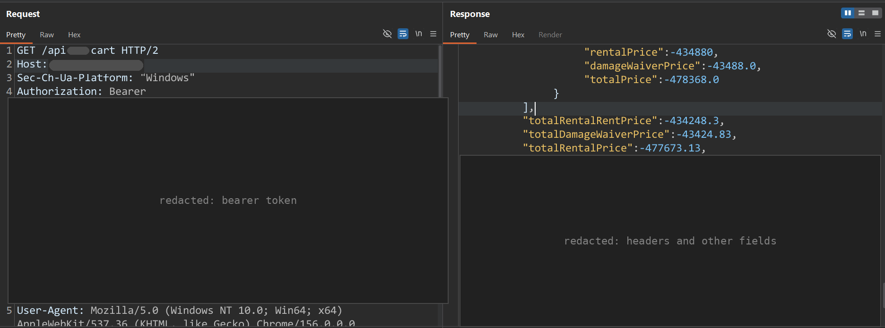

> Swapping the dates on a second add dragged a rental cart to −€477,673.13.

**Status.** Reported, fixed, and closed as a duplicate. Someone reached it before me. The reasoning is still worth writing down.

**Class.** Business logic. The cart update path did not validate the rental period. Severity is high.

---

## TL;DR

The target is an e-commerce platform with a rental feature. You pick an item, choose a start and an end date, and the backend prices the line by its duration.

Adding a rental with an end date before its start date is rejected the first time, because the create path validates the period. Adding the same product a second time returns `cartUpdateResult: UPDATED`. That update path accepts a reversed range and prices the line negative. One poisoned line pulled the rental total to **−€477,673.13**.

The create path and the update path do not share the same validation. The first write is guarded. The second write is not.

---

## Scope and ground rules

- The target and the program are redacted. I am not naming the company.
- Black-box testing, with my own account. I stopped at the cart.
- Tokens, hostnames, and the API path are redacted in the figures.

---

## 1. Mapping the feature

I opened a rentable product and watched the network tab while changing the rental dates.

The rental dates are not decoration. They ride on the cart line and drive the server-computed price.

```http Endpoint
POST /api/rental
```


*Adding a rental is a POST to the rental endpoint.*

```json Payload
{
  "productCode": "018517",
  "storeId": 39,
  "startDate": [2026, 10, 31, 17, 0, 0],
  "endDate": [2026, 11, 20, 17, 0, 0],
  "quantity": 1
}
```

The cart response gives each line a server-computed price.



*The dates travel with the line. This add was answered as an update.*

A valid rental prices correctly and positively. Reading the cart back with an authenticated `GET` shows €20 rent, €2 waiver, €22 total, and a €50 deposit. The server owns the price.



*A normal period. The total stays positive.*

That is the right design, and it also means the pricing function is the single point of failure. The question stops being whether I can tamper with the price. It becomes whether I can hand the formula an input the developer never imagined. Dates are user-controlled, so that is the lever.

---

## 2. Finding the edges of the booking window

Before trying anything clever, I probed the limits. I pushed the dates further into the future until the server pushed back.

An out-of-window period is rejected. The range is in the right order, start before end, but the end is too far in the future.

```json Request
{
  "productCode": "018517",
  "storeId": 39,
  "startDate": [2030, 10, 31, 17, 0, 0],
  "endDate": [2031, 11, 20, 17, 0, 0],
  "quantity": 1
}
```

```json Response
{
  "success": false,
  "errorCode": "RENTAL_PERIOD_INVALID",
  "cartUpdateResult": "NOT_UPDATED",
  "validationErrors": []
}
```



*The dates are in order. They are simply outside the window.*

The valid window tops out around 2031, roughly five years out. More important for the rest of the story: real validation exists on the create path. A code path inspects the rental period and refuses it with `RENTAL_PERIOD_INVALID` before the line is created.

Hold that thought. The bug is a second path that does not run this same check.

---

## 3. How strict is the date validation?

I started feeding the add-to-cart request reversed and malformed ranges.

On a fresh add, the create path holds. A reversed range is refused, and a correctly ordered range that reaches too far into the future is refused with `RENTAL_PERIOD_INVALID` and `NOT_UPDATED`. The period is checked before the line exists.

So the first write is guarded. The interesting part is what happens on the second one.

---

## 4. The second add

This is the heart of it.

I added a product, then added the same product again, and watched what the API called the result.

The second add came back as an update, not a new line.

```json Response
{
  "success": true,
  "cartUpdateResult": "UPDATED",
  "validationErrors": [],
  "cart": { … }
}
```

The cart identifies a rental line by product, not by the dates on the request. So the second add lands on the line that already exists.

One action, "add this item," resolves to two server behaviors.

- **First add, create path.** The line does not exist yet. The server creates it, runs the period validation from section 2, and prices it. The price is positive.
- **Second add, update path.** The line already exists, keyed by product. The server updates it with the new dates. This is where the reversed range gets through and the line price goes negative.

The update path takes the new start and end dates without re-running the period validation that the create path runs. Validation exists on create, the re-add is explicitly `UPDATED`, and the cart ends up holding a negative line.

The second add used a range reversed by about a year, so the duration goes strongly negative:

```json Payload
{
  "productCode": "018517",
  "storeId": 39,
  "startDate": [2031, 10, 31, 11, 0, 0],
  "endDate": [2030, 10, 31, 10, 0, 0],
  "quantity": 100
}
```

The takeaway: two code paths for one action, and only one of them is guarded. Worth hunting in any cart, wishlist, or booking flow.

---

## 5. Why the price goes negative

A pricing function shaped like this produces exactly that result:

```text Pricing
function price(item, start, end):
    hours = (end - start) / 3600
    if hours < 24:
        return ceil(hours) * item.hourlyRate
    return ceil(hours / 24) * item.dailyRate
```

With a reversed range, `hours` is negative. Any negative value is less than 24, so it falls into the hourly branch and the result is a negative line price. There is no `hours > 0` guard. The developer assumed validation had already guaranteed a positive duration. On the create path, it had. On the update path, it had not.

The second add also carried `quantity: 100`, so the negative line price is multiplied across 100 units. That is why the number gets so large.

Validation and pricing were two separate trust zones, and the update path let me skip the first one.

---

## 6. The poisoned cart

A cart is an aggregate. Once one line is negative, it drags the total down and offsets every positive line.

Straight from the cart response:

| Field | Value |
| --- | --- |
| Poisoned line `rentalPrice` | −€434,880.00 |
| Poisoned line `damageWaiverPrice` (10%) | −€43,488.00 |
| Poisoned line `totalPrice` | −€478,368.00 |
| Cart `totalRentalRentPrice` | −€434,248.30 |
| Cart `totalDamageWaiverPrice` | −€43,424.83 |
| Cart `totalRentalPrice` | −€477,673.13 |

The rent subtotal of −€434,248.30 means a positive line of +€631.70 is being swallowed by the negative one. The total is that subtotal plus the 10% damage waiver.



*The cart read back with an authenticated GET. These numbers are server-side state.*

The API response holds the negative values, so this is not a front-end rendering glitch. The rent was added to the cart, and the cart carried the negative value.

Rental lines and regular items roll up into the same cart total. The negative line offsets everything else in the cart, not only other rentals.

---

## 7. The payment layer

I stopped at the cart, so this section is about how payment processors work in general, and why that matters for a bug like this.

- A processor validates what it is sent. The amount has to be positive and above a minimum. It has no concept of what the cart should cost.
- If the backend submits one positive total, for example a €100 item offset by a −€80 line and charged as €20, the processor charges it. The number it received looks fine.
- If the total is negative, the processor rejects the amount. That protects the processor, not the merchant's inventory or books.
- The dangerous edge is a total of exactly 0. Many stores have a path for free orders, and a negative line can land the total there.

The processor is a calculator you hand a number to. The number has to be correct before it arrives.

---

## What I didn't test

Checkout. I stopped at the cart and never placed an order with a negative or zero total, so what checkout does with that total is the one open piece.

---

## How the two paths line up

```text Paths
POST /api/rental
        |
        +-- no line yet ---- create
        |                      |
        |                      +-- period refused --> RENTAL_PERIOD_INVALID
        |                      +-- period accepted -> positive price
        |
        +-- line already there -- update
                                   |
                                   +-- reversed dates
                                         |
                                         +-- negative line
                                               |
                                               +-- poisoned cart total
```

---

## Root cause

1. No shared `end > start` check on the update path. Validation lives on create only.
2. A pricing function with no check for a negative duration or a negative result.
3. The cart tolerates a line priced at zero or below.

---

## Impact

- Offset legitimately priced items, rentals or not, with a negative rental line, and pay less than their value.
- Steer a cart toward a zero total, which can skip payment depending on how checkout handles free orders.
- Inventory and revenue loss, plus messy refund and accounting side effects.

---

## Recommended fixes

1. Validate `end > start`, with the full datetime and timezone, on every path: create, update, and merge.
2. Put the period rules in one shared function called by both paths.
3. Reject non-positive durations and non-positive prices inside the pricing function itself.
4. At checkout, recompute the cart and fail if any line is `<= 0`.
5. Do not create a zero-payment order unless the free total was legitimately computed.
6. Add regression tests for reversed ranges, the edge of the booking window, add-twice, and add-after-update.

---

## Takeaways

- Hunt the second write. Create, update, and merge are often separate paths, and only one of them gets the validation. If the first add is clean, add again.
- Probe the edges. Booking-window limits are usually enforced by different code than the pricing.
- "The server computes the price" is not the end of the story. Ask what inputs the formula was never tested with.
- The payment processor is not the business logic. It only sees the number it is given.

---

**Disclosure.** Published with the program's permission. The issue was reported, fixed, and closed as a duplicate of an earlier report.

*Thanks for reading. This is my first writeup.*
